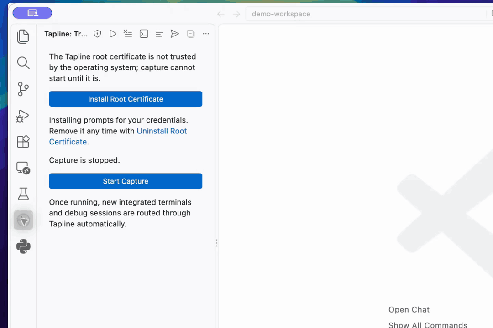

# Tapline

English | [简体中文](README.zh-CN.md)

[](https://marketplace.visualstudio.com/items?itemName=fqix.tapline)
[](https://open-vsx.org/extension/fqix/tapline)

Capture, inspect, rewrite and replay HTTP, HTTPS, HTTP/2, HTTP/3, gRPC, WebSocket and
SSE traffic without leaving VS Code. Integrated terminals and debug sessions are routed
through a local proxy — one port that accepts both HTTP CONNECT and SOCKS5 — which
decrypts configured hosts with the Tapline root CA. By default all hosts are selected;
excluded hosts pass through unchanged.

Install from the [VS Code Marketplace](https://marketplace.visualstudio.com/items?itemName=fqix.tapline)
or [Open VSX](https://open-vsx.org/extension/fqix/tapline).



_Install and trust the CA, capture an httpbin request, edit & resend it, diff it against
the original, decode grpcbin fields with the workspace `.proto`._
[MP4](docs/demo/tapline-walkthrough.mp4) · [recording notes](docs/demo/README.md)

## Features

- **Traffic panel** — a _Structure_ tree (host → path → request) in the sidebar and one
  panel with a sortable, virtualised _Sequence_ table (status/method chips, host view,
  multi-select, resizable columns) and an inspector below or beside it.
- **Inspector** — request and response side by side: Overview with timing waterfall,
  Raw, Params (query, cookies, form, multipart), Headers and trailers, Body as JSON tree
  / XML / Text / Hex / image with find-in-body. gzip, deflate, br and zstd bodies are
  decoded. JWTs found in headers are decoded to their registered claims, with local
  times and a valid / not yet valid / expired state.
- **Streams** — WebSocket frames, SSE events and gRPC messages arrive live; search,
  copy, pause and follow, filter by direction, resend a WebSocket message on the open
  connection.
- **gRPC** — length-prefixed messages (gzip/deflate, gRPC-Web) decoded with the
  workspace's `.proto` files or, without a schema, by field number; `grpc-status` colours
  the row.
- **Filter query** — terms such as `status:5xx`, `method:post`, `host:api.*`,
  `path:/v1`, `type:json`, `type:js`, `proto:h2`, `size>10k`, `dur>500`, `ip:10.0.`,
  `body:"not found"`, `header:x-id=1`, `rule:any`, `param:ssrf` and negations like
  `-status:2xx`; plain words match URL, method or status. Quick chips filter by status
  (2xx/3xx/4xx/5xx/errors), media type (JSON, JS, HTML) and WebSocket. _Statistics_
  summarises the filtered rows per host.
- **Rules** — breakpoints, rewrite, map local, map remote, block and throttle
  ([below](#rules)).
- **Fuzzing** — the first tab in (Re)Play: pick local wordlist files, insert `$FUZZ$`
  anywhere in the request, then send one request per payload; results appear in the traffic
  table.
- **Interesting parameters** — requests with parameter names from the built-in SSRF, SQLi,
  XSS, LFI, OpenRedirect and RCE lists are marked in the traffic table, and matching names
  are highlighted in the inspector ([below](#interesting-parameters)).
- **Native context menu, (Re)Play and compare** — right-click requests to replay,
  _Send to Fuzzer_ (opens (Re)Play with the fuzz settings), _Edit & Resend_, copy as cURL,
  open as text, compare, mark, annotate or delete;
  write a request or paste a curl command; compare any two rows, or a replay with its
  original, in the native diff editor.
- **Automatic capture** — new terminals and debug sessions (`node`, `python`, `go`,
  `java`, …; selected automatically by debug type) get `HTTP(S)_PROXY` plus the CA variables of common tools
  (`SSL_CERT_FILE`, `NODE_EXTRA_CA_CERTS`, `REQUESTS_CA_BUNDLE`, `CURL_CA_BUNDLE`,
  `GIT_SSL_CAINFO`, `JAVA_TOOL_OPTIONS`, …). _Copy Proxy Environment_ gives any other
  program one line of `https_proxy`, `http_proxy` and `all_proxy` (SOCKS5), quoted for
  the shell you pick.
- **Captured browser** — _Open Captured Browser_ launches Chrome, Firefox, Edge, Brave or
  Chromium with an isolated profile whose proxy is Tapline.
- **Root certificate** — install, trust and uninstall the CA in the OS store on macOS,
  Windows and Linux with one click ([below](#root-certificate)).
- **One capture per window** — every VS Code window has its own traffic, controls and
  proxy port (`tapline.port`, 3606 by default, falling back to a free port when it is
  busy); windows in the same extension storage share one sing-box process and CA, and
  the last window to close shuts them down.
- **MCP server** — Copilot Chat, Claude Code, Cursor and other assistants can list,
  search, read, replay and send captured requests ([below](#mcp-server)).
- Context menus, copy as cURL, export HAR, status-bar controls, English and 简体中文 UI.

## (Re)Play requests

Open _Tapline: (Re)Play_, paste a cURL command into the editor or use its _cURL_ import
button. Clicking any request in the traffic table fills this editor — whose first tab holds
the fuzz settings — with its method, URL, headers and body. Parsing uses curlconverter.
Multiline commands and UTF-8 data
files such as `curl -d @data.json https://example.com/api` are supported; review import
warnings before sending. Missing files, multipart file references and unsupported
transport options produce warnings. For binary uploads, select the file in Body.

- **Params and Headers:** edit key/value rows and check which entries to send;
  unchecked entries remain available in the editor. Headers also support bulk editing.
- **Authorization:** configure Basic, Bearer or a custom Authorization header; the
  header the request will send is shown below the fields.
- **Body:** choose `none`, `form-data`, `x-www-form-urlencoded`, `raw`, `binary` or
  `GraphQL`. Multipart supports text and file fields; URL-encoded forms support
  checkboxes, descriptions and bulk editing. Binary sends the selected file's bytes.
  GraphQL has Query, Variables and Operation Name fields and validates variables JSON.
- Send with **⌘↩ / Ctrl+↩**, then inspect the captured result or compare it with the
  original request. The Fuzz tab uses the same request.

The [ReqBin coverage report](docs/reqbin-curl-coverage.md) records tested examples and
import limitations.

## Fuzzing

Fuzzing is the first tab in (Re)Play. Open (Re)Play from the toolbar, or use a captured
request's _Fuzz_ button; you can also right-click a request in the table or the structure
tree and choose _Send to Fuzzer_ to open it prefilled. Clicking a row in the traffic table
fills the same editor. _Add files…_ selects local wordlists (one payload per line, up to
5 MB / 20,000 lines each); check the ones to use, then _Start fuzzing_. There is no
insertion-point list: every `$FUZZ$` in the request is filled from the same payload.
Each payload is sent through the capture proxy sequentially and appears as its own request
in the sequence table; the Fuzz tab shows status codes and errors as they arrive. _Stop_
stops after the request in flight.

For an arbitrary position, select text in any request field — URL, parameter name or value,
header name or value, authorization credential, body field — and press _Set Fuzz_. The
selection becomes `$FUZZ$`, filled verbatim with each payload — including partial values
inside a JSON string, a URL path or a header token. All markers in the request use the same
payload. The Fuzz tab lists every marked value in a _Location / Element_ table, so you can
check what will be fuzzed before starting.

## Interesting parameters

Requests whose query string or URL-encoded form body uses a name from the built-in lists get a
shield icon and a warning stripe in the sequence table; the same names are highlighted in the
inspector's Query and Form tables. The lists cover SSRF, SQLi, XSS, LFI, OpenRedirect and RCE,
including localized names in Spanish, French, German, Chinese, Japanese, Korean and Arabic.

Filter with `param:ssrf`, `param:sqli`, `param:xss`, `param:lfi`, `param:redirect`, `param:rce`
or `param:any`; prefix `-` to exclude. Only names are checked, not values or JSON bodies. Common
names such as `id`, `page` and `q` appear in several lists, so a hit is a hint, not proof.

## Settings

_Tapline: Settings_ (or the gear in the traffic panel) opens a settings tab with search.
Settings and rules live in the extension's global storage and are shared by every project
in the same VS Code profile; `settings.json` is not used. The same tab can point VS Code's
own proxy at the live capture port, and take it back off again.

| Setting                                     | Default          | Purpose                                                                  |
| ------------------------------------------- | ---------------- | ------------------------------------------------------------------------ |
| `tapline.autoStart`                         | `false`          | Start capture when VS Code opens                                         |
| `tapline.port`                              | `3606`           | Capture port; falls back to a free one when busy, `0` always asks the OS |
| `tapline.terminal.profiles`                 | openssl, git     | Variables injected into new terminals                                    |
| `tapline.ssl.hosts` / `ssl.noHosts`         | `["*"]` / `[]`   | Which hosts are decrypted, and which are excluded                        |
| `tapline.ssl.insecureUpstream`              | `true`           | Accept any upstream certificate on decrypted connections                 |
| `tapline.ssl.noProxy`                       | `[]`             | Hostnames appended to `NO_PROXY` in captured environments                |
| `tapline.maxEntries` / `tapline.maxBodyKiB` | `2000` / `512`   | Requests kept and body bytes retained                                    |
| `tapline.mcp.enabled` / `tapline.mcp.port`  | `true` / `3607`  | MCP endpoint for AI assistants                                           |
| `tapline.grpc.protoFiles`                   | `["**/*.proto"]` | Schemas for decoding gRPC messages                                       |
| `tapline.rules`                             | `[]`             | Interception rules, edited with _Tapline: Rules…_                        |

## Rules

Rules apply in order to every request whose URL matches the wildcard pattern (`*`
matches anything, a pattern without `*` is a prefix, empty matches all) and, optionally,
one of the listed methods. Open the editor with the ruler button or _Tapline: Rules…_;
_Break on This URL_ in a row's context menu adds a breakpoint. Example rule data:

```jsonc
[
    {
        "kind": "breakpoint",
        "url": "https://api.example.com/v1/orders*",
        "request": true,
        "response": true
    },
    {
        "kind": "rewrite",
        "url": "*/v1/*",
        "request": { "headers": { "X-Debug": "1", "Authorization": null } },
        "response": {
            "status": 500,
            "bodyReplace": { "pattern": "\"ok\":true", "replacement": "\"ok\":false" }
        }
    },
    { "kind": "mapLocal", "url": "*/users.json", "file": "mocks/users.json" },
    { "kind": "mapLocal", "url": "*/feature-flags", "body": "{\"beta\": true}", "status": 200 },
    { "kind": "mapRemote", "url": "https://api.example.com/*", "to": "http://localhost:8080" },
    { "kind": "block", "url": "*://telemetry.*", "status": 403 },
    { "kind": "throttle", "url": "*", "latencyMs": 800, "kbps": 256 }
]
```

| Kind         | Effect                                                                                                    |
| ------------ | --------------------------------------------------------------------------------------------------------- |
| `breakpoint` | Holds the request and/or response; the inspector shows an editor with _Continue_ and _Abort_.             |
| `rewrite`    | `method`, `url` (regex → replacement), `status`, `headers` (`null` removes), `body` or `bodyReplace`.     |
| `mapLocal`   | Answers with `file` (relative to the workspace or absolute) or `body`; `contentType` is guessed if unset. |
| `mapRemote`  | Sends the request to `to` (origin, optional path prefix), keeping the path and query; `Host` follows.     |
| `block`      | Refuses with `status` (default 403) without contacting the server.                                        |
| `throttle`   | Delays forwarding by `latencyMs` and paces both bodies at `kbps`.                                         |

Rewritten and edited bodies are sent uncompressed with `Content-Encoding` removed;
`text/event-stream` responses are never buffered, so only their status and headers can
change. Requests a rule touched show a pencil in the table and the rule names in the
overview.

## Root certificate

The CA lives in the extension's global storage (_Tapline: Copy Root Certificate Path_).
Capture starts only once the OS trusts it; the sidebar and status bar offer to install
it, and _Tapline: Uninstall Root Certificate_ removes it.

| Platform | Store                                                           |
| -------- | --------------------------------------------------------------- |
| macOS    | login keychain via `security` (system password dialog)          |
| Windows  | current-user Trusted Root via `certutil` (confirmation dialog)  |
| Linux    | distribution anchor directory + update command, run with `sudo` |

The captured-browser command makes Firefox trust the OS certificate store (enterprise
roots on Windows/macOS, the p11-kit trust module on Linux), so the installed Tapline CA
works for HTTPS. Snap/flatpak browsers still need a manual import. Set
`tapline.ssl.hosts` to `[]` to capture without decryption or any certificate.

TLS interception follows host inclusion/exclusion settings. Unlike Charles's
opt-in default, Tapline keeps `tapline.ssl.hosts` at `["*"]` (all hosts). Set it to
`[]` or exclude a host: its HTTPS/WSS connections pass through unchanged and are
marked **Undecrypted**. Only connection metadata and byte counts are recorded;
clients see the original server certificate, including when they use certificate pinning.
With no decryption hosts configured, terminal/debug environments inject only proxy
settings, preserving the client's native CA trust.

Add a hostname or wildcard to `tapline.ssl.hosts` to decrypt its traffic; `*` opts in
all hosts. `tapline.ssl.noHosts` and `!` patterns exclude hosts and take precedence.
Existing saved patterns are preserved. Changes apply to new connections, so reconnect
or restart capture to replace existing tunnels. (Re)Play explicitly inspects its own
request without changing the host policy for other clients.

`tapline.ssl.insecureUpstream` is enabled by default: decrypted connections accept
self-signed, expired and hostname-mismatched upstream certificates. Disable it to
verify the upstream server certificate. Explicitly saved settings are preserved.

An opted-in connection that fails TLS is not automatically retried or switched to
passthrough. Exclude pinned hosts before connecting. Tapline uses Go TLS rather than
Charles's TLS implementation: malformed certificate acceptance is not guaranteed to
match, even with `ssl.insecureUpstream` enabled.

## MCP server

The capture agent serves an [MCP](https://modelcontextprotocol.io) endpoint at
`http://127.0.0.1:3607/mcp` (Streamable HTTP, loopback only, no extra process) while any
window with Tapline is open. Tools: `list_sessions`, `status`, `list_requests`, `search`,
`get_request`, `get_body`, `replay`, `send`, `export_har`, `start_capture`,
`stop_capture`, `set_recording`, `clear`, `delete`; resources
`tapline://sessions/{sessionId}/requests/{id}`. With window isolation each window is a
session: `list_sessions` shows them, and the other tools take `sessionId` (required
once more than one window is open).

_Tapline: Configure MCP Server…_ gives one-click install in Cursor, the URL, an
`mcp.json` snippet or a `claude mcp add` command.

## How it works

A Node agent drives a bundled, patched [sing-box](third_party/patches/sing-box/README.md):
sing-box terminates TLS with leaf certificates minted from the Tapline CA and streams
bodies through the agent, which records them, applies rules and passes them on.
The interception engine is the separate Go module in [engine](engine/README.md); the
patch series only adds the glue that embeds it in sing-box.

## Development

Requires Node 24 LTS, Go 1.27+ and git.

```sh
git clone --recurse-submodules https://github.com/fqix/tapline.git && cd tapline
nvm use               # Node 24 LTS (.nvmrc)
npm ci --ignore-scripts # use the WASM parser; skip unused native addons
npm rebuild esbuild
npm run core:build     # patch and build sing-box into core/<platform>-<arch>/
npm run build          # esbuild → dist/
npm test               # vitest: unit tests plus integration tests against the core
npm run test:e2e       # the extension inside a real VS Code (downloads it on first run)
npm run package        # VSIX for this platform (package:all for all six)
```

Press F5 to launch the extension development host. CI builds, tests and packages every
platform on each push and runs the end-to-end suite on one runner per OS.

### Troubleshooting

**`Tapline could not start capture: ENOENT ... core/<platform>-<arch>/sing-box.build.json`** -
the bundled sing-box core is missing. From a source checkout, build it for your host and
reload:

```sh
npm run core:build
```

When packaging/installing a VSIX, use the package script so the platform core is staged
into the VSIX:

```sh
node scripts/package.mjs --target linux-x64
code --install-extension tapline-linux-x64-*.vsix --force
```

Replace `linux-x64` with your target (`darwin-arm64`, `darwin-x64`, `linux-arm64`,
`win32-x64`, `win32-arm64`). Plain `npx @vscode/vsce package` does not stage the core.

## Releasing

Push/PR CI only builds and tests. Add the version to [CHANGELOG.md](CHANGELOG.md), bump and
push the tag:

```sh
npm version patch && git push --follow-tags
```

The [release workflow](.github/workflows/release.yml) rebuilds all platforms, creates a
GitHub release and attaches the VSIX files to it. It does not publish to any extension
marketplace, so forks get installable packages without marketplace credentials.

## Licence

MIT. The bundled sing-box core is GPL-3.0; its source revision, patches and notices ship
next to each binary.
