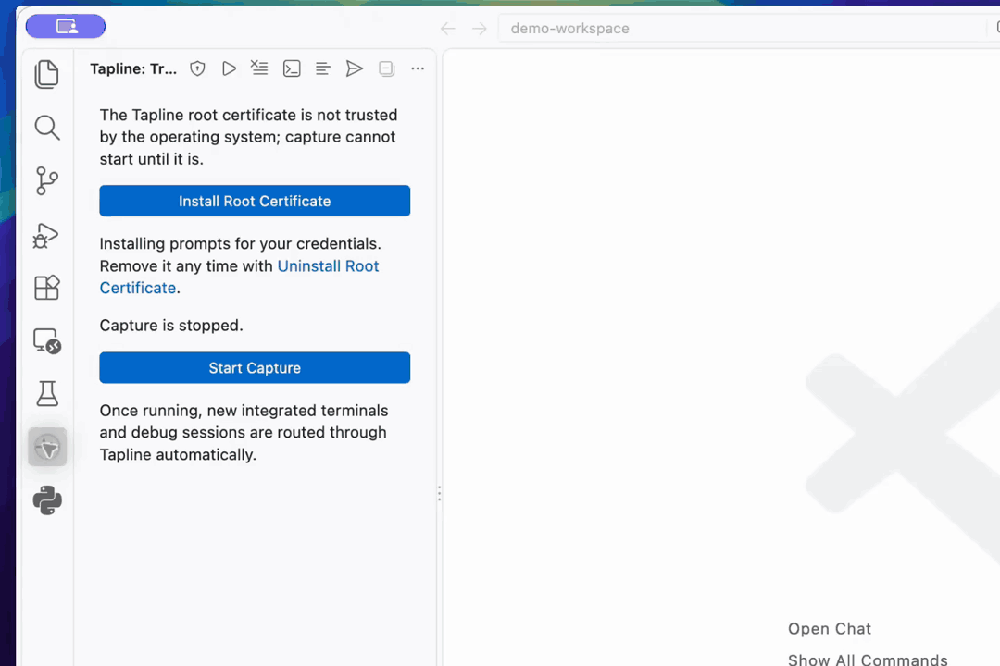

# Tapline

[English](README.md) | 简体中文

[](https://marketplace.visualstudio.com/items?itemName=fqix.tapline)
[](https://open-vsx.org/extension/fqix/tapline)

不离开 VS Code 即可捕获、检查、改写和重放 HTTP、HTTPS、HTTP/2、HTTP/3、gRPC、WebSocket
和 SSE 流量。集成终端和调试会话经由本地代理转发——同一个端口同时接受 HTTP CONNECT 和
SOCKS5——并使用 Tapline 根 CA 解密选中的域名。默认选中全部主机，被排除的主机原样透传。

从 [VS Code Marketplace](https://marketplace.visualstudio.com/items?itemName=fqix.tapline)
或 [Open VSX](https://open-vsx.org/extension/fqix/tapline) 安装。



_安装并信任 CA，抓取 httpbin 请求，编辑并重发，与原请求 Diff，再用工作区的 `.proto`
解出 grpcbin 的字段名。_ [MP4](docs/demo/tapline-walkthrough.mp4) ·
[录制说明](docs/demo/README.md)

## 功能

- **流量面板** — 侧边栏是 _结构_ 树（主机 → 路径 → 请求），编辑区只有一个面板：可排序、
  虚拟滚动的 _序列_ 表格（状态码/方法快捷筛选、按主机查看、多选、可调列宽），详情放在
  下方或右侧。
- **详情** — 请求与响应并排：带时序瀑布图的概览、Raw、参数（Query、Cookie、表单、
  multipart）、Headers 与 Trailers，正文支持 JSON 树 / XML / 文本 / 十六进制 / 图片并可
  在正文中查找。gzip、deflate、br、zstd 正文自动解码。请求头中的 JWT 会解码出注册声明，
  时间转为本地时间，并标明有效 / 尚未生效 / 已过期。
- **流式消息** — WebSocket 帧、SSE 事件、gRPC 消息实时到达；可搜索、单条复制、暂停与
  跟随最新、按方向筛选，并在原连接上重发 WebSocket 消息。
- **gRPC** — 拆出 length-prefixed 消息（含 gzip/deflate 与 gRPC-Web），用工作区的
  `.proto` 解出字段名，没有 schema 时按字段编号解码；`grpc-status` 决定行的颜色。
- **过滤语法** — 支持 `status:5xx`、`method:post`、`host:api.*`、`path:/v1`、
  `type:json`、`type:js`、`proto:h2`、`size>10k`、`dur>500`、`ip:10.0.`、`body:"not found"`、
  `header:x-id=1`、`rule:any`、`param:ssrf` 以及 `-status:2xx` 这样的取反；普通词匹配 URL、方法或
  状态码。快捷标签支持一键过滤状态码（2xx/3xx/4xx/5xx/errors）、媒体类型（JSON、JS、HTML）及 WebSocket。_统计_ 按主机汇总当前过滤出的请求。
- **规则** — 断点、改写、映射到本地、映射到远程、拦截和限速（[见下文](#规则)）。
- **模糊测试** — （重）放面板的第一个标签页：选择本地字典文件，在请求任意位置插入 `$FUZZ$`，逐条发送；结果显示在流量表格中。
- **可疑参数** — 命中内置 SSRF、SQLi、XSS、LFI、OpenRedirect、RCE 参数名的请求会在序列表格中标记，详情里对应参数名高亮（[见下文](#可疑参数)）。
- **原生右键菜单、（重）放与对比** — 右键点击请求支持重放、_发送到模糊测试_、_编辑并重发_、复制为 cURL、以文本打开、对比、星标、备注与删除；支持从零编写请求或粘贴 curl 命令；任选两行或重发记录与原请求在原生差异编辑器中对比。
- **自动抓包** — 新终端和调试会话（`node`、`python`、`go`、`java`……按调试类型自动选择）自动获得
  `HTTP(S)_PROXY` 和常见工具的 CA 变量（`SSL_CERT_FILE`、`NODE_EXTRA_CA_CERTS`、
  `REQUESTS_CA_BUNDLE`、`CURL_CA_BUNDLE`、`GIT_SSL_CAINFO`、`JAVA_TOOL_OPTIONS`……）。
  其他程序用 _复制代理环境变量_：一行 `https_proxy`、`http_proxy` 和 `all_proxy`
  （SOCKS5），并按所选 shell 转义。
- **抓包浏览器** — _打开抓包浏览器_ 会以独立配置启动 Chrome、Firefox、Edge、Brave 或
  Chromium，其代理默认为 Tapline。
- **根证书** — 在 macOS、Windows、Linux 的系统证书存储中一键安装、信任和卸载 CA
  （[见下文](#根证书)）。
- **每个窗口独立抓包** — 每个 VS Code 窗口拥有独立的流量、控制和代理端口
  （`tapline.port`，默认 3606，被占用时自动退回空闲端口）；同一扩展存储下的窗口共用
  一个 sing-box 进程和 CA，最后关闭的窗口负责关停。
- **MCP 服务器** — Copilot Chat、Claude Code、Cursor 等助手可以列出、搜索、读取、重放
  和发送抓到的请求（[见下文](#mcp-服务器)）。
- 原生右键菜单、复制为 cURL、导出 HAR、状态栏控制、中英文界面。

## （重）放请求

打开 _Tapline: （重）放请求…_，将 cURL 命令粘贴到编辑器，或使用顶部的 _cURL_ 导入按钮。点击序列表格中的任意请求，会把方法、URL、请求头和正文填入这里；模糊测试设置就在同一面板的第一个标签页。
解析使用 curlconverter，支持多行命令和 UTF-8 数据文件，例如
`curl -d @data.json https://example.com/api`。发送前请查看导入警告：文件缺失、multipart
文件引用及无法映射的传输选项都会提示；上传二进制文件请在 Body 中选择文件。

- **Params 和 Headers：** 以键值行编辑，勾选要发送的条目；取消勾选的内容仍保留在
  编辑器中。Headers 也支持批量文本编辑。
- **Authorization：** 配置 Basic、Bearer 或自定义 Authorization 请求头；下方会显示
  实际将要发送的请求头。
- **Body：** 支持 `none`、`form-data`、`x-www-form-urlencoded`、`raw`、`binary` 和
  `GraphQL`。multipart 支持文本和文件字段；URL 编码表单支持勾选、描述和批量编辑；
  binary 按原始字节发送所选文件。GraphQL 提供 Query、Variables 和 Operation Name，
  并校验变量 JSON。
- 按 **⌘↩ / Ctrl+↩** 发送，然后查看捕获结果或与原请求对比。_Fuzz_ 标签页使用同一份请求。

[ReqBin 测试覆盖报告](docs/reqbin-curl-coverage.md)列出了已验证的示例和导入限制。

## 模糊测试

模糊测试是（重）放面板的第一个标签页。从工具栏打开（重）放，或点击抓到请求的 _Fuzz_ 按钮；也可以在序列表格或结构树中右键请求，选择 _发送到模糊测试_，直接填入该请求。点击序列表格中的请求也会填入同一份编辑器。选好本地字典（每行一个载荷，每个文件最多 5 MB / 20,000 行）、勾选要使用的文件后即可开始；不再需要勾选插入点，请求中每一处 `$FUZZ$` 都会用同一条载荷填充。每个载荷经抓包代理依次发送，作为独立请求出现在序列表格；_Fuzz_ 标签页实时显示状态码和错误。停止会在当前请求完成后停下。

要指定任意位置，可在任意请求字段中选中一段文本——URL、参数名或值、请求头名或值、授权凭据、正文——点击 _设置模糊点_：选中的文本会变成 `$FUZZ$`，逐条用载荷原样替换，适用于 JSON 字符串内部、URL 路径或请求头 token 等局部内容。请求中的多个标记会用同一条载荷同时填充。_Fuzz_ 标签页会用“位置 / 元素”表格列出所有已标记的值，开始之前即可确认要模糊测试的内容。

## 可疑参数

查询字符串或 URL 编码表单体中，名称命中内置列表的请求会在序列表格中显示盾牌图标和警告色；详情的 Query/Form 表格里对应参数名也会高亮。列表覆盖 SSRF、SQLi、XSS、LFI、OpenRedirect 和 RCE，并包含西班牙语、法语、德语、中文、日语、韩语和阿拉伯语的名称变体。

可用 `param:ssrf`、`param:sqli`、`param:xss`、`param:lfi`、`param:redirect`、`param:rce` 或 `param:any` 过滤；加 `-` 取反。只检查参数名，不检查参数值或 JSON 正文。`id`、`page`、`q` 等常见名称出现在多个列表中，因此命中只是提示，不是结论。

## 设置

_Tapline: 设置_（或流量面板的齿轮）打开带搜索的设置标签页。设置和规则保存在扩展的
全局存储中，同一 VS Code 配置文件下的所有项目共用，不写入 `settings.json`。该页还可以
把 VS Code 自身的代理指向当前抓包端口，也可以再撤销。

| 设置项                                      | 默认值           | 作用                                                   |
| ------------------------------------------- | ---------------- | ------------------------------------------------------ |
| `tapline.autoStart`                         | `false`          | VS Code 启动时自动开始抓包                             |
| `tapline.port`                              | `3606`           | 抓包端口；被占用时退回空闲端口，`0` 表示总是由系统分配 |
| `tapline.terminal.profiles`                 | openssl, git     | 向新终端注入的变量                                     |
| `tapline.ssl.hosts` / `ssl.noHosts`         | `["*"]` / `[]`   | 解密哪些主机，以及排除哪些主机                         |
| `tapline.ssl.insecureUpstream`              | `true`           | 解密连接是否接受任意上游证书                           |
| `tapline.ssl.noProxy`                       | `[]`             | 追加到抓包环境 `NO_PROXY` 的域名                       |
| `tapline.maxEntries` / `tapline.maxBodyKiB` | `2000` / `512`   | 保留的请求数与正文字节数                               |
| `tapline.mcp.enabled` / `tapline.mcp.port`  | `true` / `3607`  | 供 AI 助手使用的 MCP 端点                              |
| `tapline.grpc.protoFiles`                   | `["**/*.proto"]` | 解码 gRPC 消息用的 schema                              |
| `tapline.rules`                             | `[]`             | 拦截规则，用 _Tapline: 规则…_ 编辑                     |

## 规则

规则按顺序应用于 URL 匹配通配模式（`*` 匹配任意内容，不含 `*` 时按前缀匹配，留空匹配
全部）且方法匹配（可选）的每个请求。点击尺子按钮或 _Tapline: 规则…_ 打开编辑器；行的
右键菜单中的 _在此 URL 上设置断点_ 直接添加断点。规则数据示例：

```jsonc
[
    {
        "kind": "breakpoint",
        "url": "https://api.example.com/v1/orders*",
        "request": true,
        "response": true
    },
    {
        "kind": "rewrite",
        "url": "*/v1/*",
        "request": { "headers": { "X-Debug": "1", "Authorization": null } },
        "response": {
            "status": 500,
            "bodyReplace": { "pattern": "\"ok\":true", "replacement": "\"ok\":false" }
        }
    },
    { "kind": "mapLocal", "url": "*/users.json", "file": "mocks/users.json" },
    { "kind": "mapLocal", "url": "*/feature-flags", "body": "{\"beta\": true}", "status": 200 },
    { "kind": "mapRemote", "url": "https://api.example.com/*", "to": "http://localhost:8080" },
    { "kind": "block", "url": "*://telemetry.*", "status": 403 },
    { "kind": "throttle", "url": "*", "latencyMs": 800, "kbps": 256 }
]
```

| 类型         | 效果                                                                                              |
| ------------ | ------------------------------------------------------------------------------------------------- |
| `breakpoint` | 暂停请求和/或响应；详情面板显示编辑器，带 _继续_ 和 _中止_。                                      |
| `rewrite`    | `method`、`url`（正则 → 替换）、`status`、`headers`（`null` 表示删除）、`body` 或 `bodyReplace`。 |
| `mapLocal`   | 用 `file`（相对工作区或绝对路径）或 `body` 响应；`contentType` 留空时自动推断。                   |
| `mapRemote`  | 把请求发到 `to`（源，可带路径前缀），保留路径和查询串；`Host` 头随之更新。                        |
| `block`      | 不访问服务器，直接以 `status`（默认 403）拒绝。                                                   |
| `throttle`   | 转发前延迟 `latencyMs`，两个方向的正文都按 `kbps` 限速。                                          |

改写或编辑过的正文以未压缩形式发送并移除 `Content-Encoding`；`text/event-stream` 响应
不会被缓冲，只能改状态码和头。被规则处理过的请求在列表中显示铅笔图标，概览里列出规则名。

## 根证书

CA 位于扩展的全局存储目录（_Tapline: 复制根证书路径_）。只有系统信任了 CA 才会开始
抓包；侧边栏和状态栏会提示安装，_Tapline: 卸载根证书_ 可将其移除。

| 平台    | 证书存储                                              |
| ------- | ----------------------------------------------------- |
| macOS   | 登录钥匙串，通过 `security`（系统密码对话框）         |
| Windows | 当前用户受信任的根证书，通过 `certutil`（确认对话框） |
| Linux   | 发行版锚点目录 + 更新命令，在终端中以 `sudo` 执行     |

_打开抓包浏览器_ 会让 Firefox 信任系统证书存储（Windows/macOS 使用企业根证书，Linux 加载
p11-kit trust 模块），因此已安装的 Tapline CA 可用于 HTTPS；snap/flatpak 浏览器仍需手动导入。
将 `tapline.ssl.hosts` 设为 `[]` 可在不解密、不安装证书的情况下抓包。

TLS 解密按域名启用和排除。与 Charles 默认不解密不同，Tapline 保留
`tapline.ssl.hosts = ["*"]`，默认解密全部主机。设为 `[]` 或排除指定域名后，
对应 HTTPS/WSS 连接原样透传，列表标记**未解密**，只记录连接信息和字节数。客户端看到服务端原始证书，
包括启用 SSL pinning 的客户端。未配置解密域名时，终端和调试会话只注入代理配置，
保留客户端原有的 CA 信任设置。

在 `tapline.ssl.hosts` 添加域名或通配符即可解密，`*` 表示全部主机；
`tapline.ssl.noHosts` 和 `!` 模式用于排除，且排除规则优先。已有保存的配置保持不变。
配置修改只影响新连接，需重新连接或重启抓包才能替换已有隧道。
（重）放是主动发出的检查请求，仅解密自身连接，不改变其他客户端的域名策略。

主动开启解密后遇到 TLS 错误，不自动重试或改为透传。请提前排除有 pinning 的域名。
Tapline 使用 Go TLS，无法保证与 Charles 对异常证书的接受范围完全相同；
`ssl.insecureUpstream` 也不能绕过证书格式解析错误。

## MCP 服务器

只要有窗口加载了 Tapline，抓包代理就在 `http://127.0.0.1:3607/mcp` 提供
[MCP](https://modelcontextprotocol.io) 端点（Streamable HTTP，仅监听本地回环，无额外
进程）。工具：`list_sessions`、`status`、`list_requests`、`search`、`get_request`、
`get_body`、`replay`、`send`、`export_har`、`start_capture`、`stop_capture`、
`set_recording`、`clear`、`delete`；资源 `tapline://sessions/{sessionId}/requests/{id}`。
窗口隔离下每个窗口是一个会话：`list_sessions` 列出它们，其他工具接受 `sessionId`
（多个窗口时必填）。

_Tapline: 配置 MCP 服务器…_ 提供一键安装到 Cursor、复制 URL、`mcp.json` 片段或
`claude mcp add` 命令。

## 工作原理

Node agent 驱动随扩展打包的、打了补丁的 [sing-box](third_party/patches/sing-box/README.md)：
sing-box 用 Tapline CA 签发的叶证书终止 TLS，把正文流式传给 agent，后者记录、应用规则
后转发。

## 开发

需要 Node 24 LTS、Go 1.27+ 和 git。

```sh
git clone --recurse-submodules https://github.com/fqix/tapline.git && cd tapline
nvm use               # Node 24 LTS (.nvmrc)
npm ci --ignore-scripts # 使用 WASM 解析器，跳过未使用的原生插件
npm rebuild esbuild
npm run core:build     # 打补丁并构建 sing-box 到 core/<platform>-<arch>/
npm run build          # esbuild → dist/
npm test               # vitest：单元测试 + 针对核心的集成测试
npm run test:e2e       # 在真实 VS Code 中运行扩展（首次运行会下载 VS Code）
npm run package        # 当前平台的 VSIX（package:all 构建全部六个）
```

按 F5 启动扩展开发宿主。CI 在每次 push 时构建、测试并打包所有平台，并在每个操作系统的
一台 runner 上运行端到端测试。

### 排错

**`Tapline could not start capture: ENOENT ... core/<platform>-<arch>/sing-box.build.json`** -
缺少打包的 sing-box 核心。源码开发时，为当前平台构建核心后重载：

```sh
npm run core:build
```

打包/安装 VSIX 时，使用打包脚本把对应平台核心放入 VSIX：

```sh
node scripts/package.mjs --target linux-x64
code --install-extension tapline-linux-x64-*.vsix --force
```

把 `linux-x64` 换成你的目标平台（`darwin-arm64`、`darwin-x64`、`linux-arm64`、
`win32-x64`、`win32-arm64`）。直接 `npx @vscode/vsce package` 不会放入核心。

## 发版

Push/PR CI 只构建和测试。在 [CHANGELOG.md](CHANGELOG.md) 中加入新版本，升级版本号并推送 tag：

```sh
npm version patch && git push --follow-tags
```

[release 工作流](.github/workflows/release.yml)会重新构建所有平台，创建 GitHub release 并把
VSIX 附加到该 release 上；不会发布到任何扩展市场，因此 fork 无需市场凭据也能得到可安装的包。

## 许可证

MIT。随扩展打包的 sing-box 核心为 GPL-3.0，其源码修订、补丁和声明随每个二进制一起发布。
